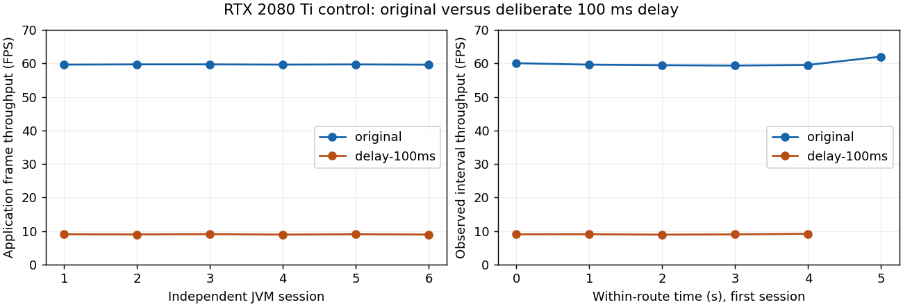

# Reusable benchmark workflows passed bounded live controls

The maintained runner supports fast functional validation, short paired development comparisons, an extensible profiler, and frozen contribution/release campaigns. Live controls exercised native Windows RTX 2080 Ti and Asahi M1. These controls establish usable measurement and recovery workflows; they accept no optimization and grant no universal performance or perceptual claim.

The deliberate 100 ms per-frame delay reduced throughput by a median **84.95%** across six fresh Windows JVMs. The conservative median interval was **−85.07% to −84.84%**, with achieved coverage 96.875% for the requested 95% interval. The frozen policy correctly rejected the candidate. Original throughput was capped near 60 FPS: this tests delivered-throughput regression sensitivity, not uncapped rendering headroom or sensitivity to a 1% change. The timeline panel divides counts by the associated observed intervals; its last bin can be partial. Full interactive reports retain exact bins and frame records.

## What was exercised

| Boundary | Executed evidence and meaning |
| --- | --- |
| Fast lifecycle validation | Ready-session validation passed in 11.6 seconds on Windows and 18.9–21.9 seconds on Asahi, including actual activation, Off, Cancel and failed Apply restoration. The standalone `./verify --runtime` also passed in 44.0 seconds including startup |
| Short development loop | Paired original/identity comparisons took 32–48 seconds on Windows and 35–37 seconds on Asahi. A final natural translation completed in 37.1 seconds. Startup/build are separate costs |
| Human and agent profiling | Real frame streams, CPU/GPU stage spans, source joins, exact Reimagined mapping and an unmapped MakeUp path. Offline browser checks exercised time selection, panning, stage selection, hover and CSV export |
| Quality capture | Final Asahi translation delivered eight images per arm at 500 ms requested cadence, zero drops, correct camera alignment, and maximum gaps 540/555 ms. Windows delivered nine images per arm including the endpoint, with maximum gaps 505/506 ms; that comparison took 23.7 seconds. A deliberately magenta shader was visibly detected. This does not establish sensitivity to brief shimmer or imperceptibility |
| Observer effects | Frame/stage/memory-control comparisons retained all observations. Short-run drift prevented a precise overhead estimate. Sampled diagnostics visibly perturb some frames; they remain optional and cannot replace minimally instrumented outcomes |
| Conditions and combinations | Night/rain route completed in 31.8 seconds. Four-cell original/A/B/A+B controls completed in 56.2 seconds on Asahi and 44.1 seconds on Windows; both providers actually executed. Its noisy interaction estimate is descriptive, not a product interaction claim |
| Installation control | MakeUp rendered with the main mod absent and installed-Off in separate processes (41.76/41.81 FPS, one pair). Common measurement helpers remain. This does not establish zero overhead. Native Reimagined without the main mod failed Iris texture-unit allocation on Asahi; that blocked control remains preserved |
| Failure and recovery | Invalid module selection produced an immutable failure; explicit recovery restored state and allowed a new capture. Changed executable input was refused before command submission. Linux and Windows watchdog controls passed normal exit, deadline, direct-parent loss and campaign-ancestor loss |
| Sustained and resumable campaigns | Four five-minute captures completed across two fresh Windows JVMs (about 71,400 frames total), with clean closure and no campaign failures. The two-session policy remained inconclusive. A separate campaign paused after one closed session and resumed its remaining session without replay |
| Real interruption | Deadline stopped the game mid-window, retained 45 chunks, and produced no completed-window receipt. A new session restored the same world's journal and original player motion, captured successfully and closed with no pending journals |
| Offline reuse | Receipt verification recomputes frame summaries and elapsed bins, verifies quality images/cadence against original observations, and checks activation/configuration joins. Separate report rebuilding preserves raw records and identifies its source/renderer. History separates incompatible contexts and retains failed attempts. Browser fixtures verify zero-throughput stall bins and missing interval gaps |

## Conditions and limitations

Evidence level: live-functional plus bounded live measurement controls. RTX 2080 Ti ran native Windows, NVIDIA driver 610.88, Microsoft Java 21 and the observed **1024×768** native surface. Asahi ran Apple M1/Mesa, pinned Temurin Java 21 and **2560×1600**. These are separate environments. Runtime tuples, original archive hashes, effective options, resources, loaded classes, telemetry availability and executed-source snapshots are in each session. Neither historical monitor sizes nor another Java distribution are substituted silently.

World preparation preserves an identified original and one working copy. The natural world has prior historical exposure; it is not a holdout. Routes advance with 20 Hz simulation ticks and record actual rendered-camera checkpoints. Creative flight, gravity, velocity, pose and world conditions have owned restoration preimages. Integrated-server activity still prevents bit-exact repeated gameplay.

Failed pilots remain evidence: startup publication ordering; synchronous image encoding that slowed simulation; image backlog/cadence failures; a warmup camera falling under gravity; and Windows input hashing accidentally traversing the asset tree. Their bounded fixes were exercised subsequently. No failure was converted to a successful replicate or silently retried in place.

GPU stages are sampled public engine/Iris shadow/main boundaries. They are shared spans, not exclusive effect-body or GPU-occupancy costs. Mapping does not invent AO/fog/reflection splits. Unknown original/derived packs remain unmapped. Tile-based GPU placement and instrumentation perturbation limit attribution. The final Windows diagnostics retained one pending query in some streams; those missing completions remain visible and cannot establish all-frame GPU outcomes. Application frame production does not measure displayed smoothness or input latency.

Small effects, longer horizons, new packs/options/dimensions, DH rendering, PBR material use, macOS and new mechanisms require their own declared evidence. A complete campaign is not a release certificate. Independent-session precision, enforced eligibility, relevant adverse cases, actual combinations and explicit perceptual review remain contribution obligations. Frozen gain/harm/quality margins are chosen for the contribution, not inferred from these controls.

## Portable validation

The final portable gate passed 104 Python tests and 38 Java tests. A fresh check executed all 99 Gradle check tasks without task reuse; underlying dependency, tool and compilation-artifact caches remained available. Later focused tests and report changes passed the full gate again. Local pre-commit runs that same gate. Live checks remain explicit; no remote CI was added.

## Decision

Retain the runner, development-only controllers, reusable definitions, focused tests, reports and project benchmark skill. Keep the default development loop lightweight. Use qualification for substantial contributions/releases, with scope-specific coverage and policy. No optimization or approximation is retained by this result.

## Evidence and executed source

Compact figure inputs and independent-session effects are in [result.json](result.json). Regenerate `chart.png` with Python and Matplotlib 3.10.7: `python figure.py` in this folder. The [regeneration source](figure.py) reads only the compact JSON. No plot library is required by the runner.

Raw artifacts live under `/home/philip/.local/share/shaderlod/evidence`; the selected evidence manifest beside this result records exact paths and hashes. Each supervised session preserves its executed inputs and classes in `inputs.tar`; Windows transfers are separately retained source snapshots. Source was uncommitted during qualification and was frozen per attempt. Some earlier Windows class deployments did not refresh its Java source files: `benchmark-windows-source-bridge-09.json` joins the deployed executable members to a byte-identical Asahi build/source archive. Final Windows deployment includes current sources as well as classes. Exact bytecode and dependencies remain preserved even where source lineage needs this bridge. Git checkpoints describe the resulting implementation, not a claim that earlier runs executed the final commit byte-for-byte.

The six-JVM campaign is preserved locally at `benchmark-rtx2080ti-sensitivity-02`. Other principal records include `benchmark-natural-final-01`, `benchmark-quality-asahi-final-03`, `benchmark-profiler-final-02`, `benchmark-weather-01`, `benchmark-interaction-01`, `benchmark-installation-makeup-01`, `benchmark-interruption-session-01`, `benchmark-interruption-recovery-01`, `benchmark-final-session-02`, `benchmark-drift-session-01`, `benchmark-history-final-02` and `benchmark-final-standalone-functional-01.json`. Windows campaign continuation and sustained evidence are preserved in `benchmark-native-campaigns-final`; final validation, quality, combination and profiler evidence are in `benchmark-native-live-final`.

The median interval follows the binomial order-statistic method described by [NIST](https://itl.nist.gov/div898/software/dataplot/refman1/auxillar/mediancl.htm). It assumes independent comparable session effects; it cannot create independence or representativeness. Timers follow the limitations in the [Khronos timer-query specification](https://registry.khronos.org/OpenGL/extensions/ARB/ARB_timer_query.txt). NVIDIA telemetry uses [NVML device-query units](https://docs.nvidia.com/deploy/nvml-api/latest/api/group__nvmlDeviceQueries.html); unsupported readings remain unavailable.

[Selected evidence manifest](manifest.json) sha256:7f589d9d9d56c188a74f9b196dac12a0292cb57b78fca06ae95886fa4ffea7bd

2026-11-12 location correction: the selected manifest now names the canonical artifact directory after the repository rename. All recorded artifact hashes are unchanged. Historical path compatibility follows the [result specification](../../docs/results.md#historical-artifact-access).
